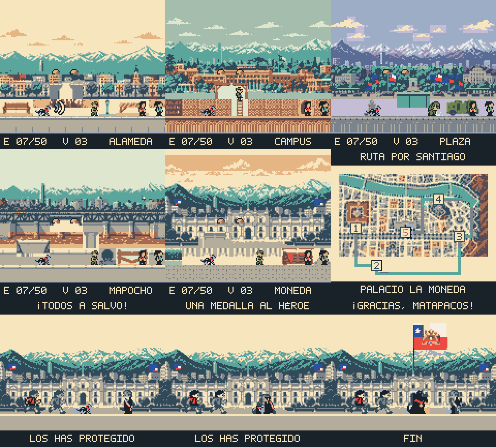

# Negro Matapacos

A Game Boy Color platformer about the Chilean street dog Negro Matapacos, built around helping students through the streets of Santiago. The intended runtime is GBDK-2020.

The project now includes a **playable GBC prototype** using the approved 16 x 16 sprites and eight-frame run cycle. Five horizontal stages run from Alameda through Campus, Plaza Dignidad and Río Mapocho to La Moneda. Movement, variable-height jumping, double-tap sprint, tile collisions, scrolling, police patrols, bark stuns, empanadas, checkpoints, lives, pause/retry, student rescue and sequential map unlocks are implemented. The river ends with a net officer boss; the palace ends with a water-cannon vehicle boss. The final rescue leads to the medal ceremony and an animated presidential-standard raising. Map locations 1 and 2 have exchanged positions; the stage order stays the same.

Every fresh boot shows an English / Español selector before Start Game appears. Interface and dialogue follow the confirmed language; text embedded in world artwork stays Spanish. Progress and collected empanadas survive deaths and revisits during the session. Starting a new game resets progress and retains the chosen language. This prototype has no battery save.

Each of the first four rescues ends on an illustrated story screen linking the next location to the students' escape. The revised illustrations match the original title's shaded dog, red bandana and warm Santiago scenery: a campus reunion, flags at Plaza Dignidad, a river escape and the palace showdown. A larger picture area and shorter three-line speech bubble replace the repeated status lines. Dialogue follows the chosen language; scenic lettering stays Spanish. Retained sources and built-in image generation prompts are in `assets/source/story-*.png` and `assets/source/story-prompts.json`. Press A or Start to continue to the world map; a held button cannot skip the interlude or immediately enter the next level.

After the final rescue and flag-raising, a matching illustrated end card shows a fictional president placing a gold medal over Matapacos's red bandana, with the rescued students celebrating at La Moneda. The heading reads **THE END / FIN** and the president's speech follows the chosen language. It stays onscreen until a fresh A/Start press. Source art and its built-in generation prompt are retained as `assets/source/story-medal.png` and `assets/source/ending-medal-prompt.json`; actual ROM captures are `build/ending-final-en/es.png`, with 4x previews beside them.

## Build and play

The tested compiler is **GBDK-2020 4.5.0, Windows x64**. Place its extracted `gbdk` folder at the project root, set `GBDK_HOME` to that folder, or use the free project-local installer:

```powershell
powershell -ExecutionPolicy Bypass -File tools/setup-gbdk.ps1
node tools/build-rom.cjs
```

The build produces `build/matapacos.gbc`, a 256 KiB GBC-only MBC5 ROM, plus compiler/linker reports. It regenerates runtime banked resources from the retained art; no image service or paid API is called. Install the declared Sharp dependency with `npm install` if it is not already supplied by the Codex bundled runtime.

Open the ROM in a GBC emulator, or run the free local PyBoy window:

```powershell
powershell -ExecutionPolicy Bypass -File tools/setup-pyboy.ps1
powershell -ExecutionPolicy Bypass -File tools/run-game.ps1
```

The launcher uses an installed Python or the local Codex Python runtime. Emulator packages remain in `.tools/pyboy`; neither setup script changes global installations. Set `GAME_PYTHON` when using a different interpreter for the test runner.

| Game control | PyBoy keyboard |
| --- | --- |
| Move / choose a level | Arrow keys |
| A: confirm / jump; release early for a short jump | X |
| B: bark / menu back | Z |
| Start: begin / pause / resume | Enter |
| Sprint | Tap a direction twice, then hold it |

Bark near an officer to stun them. Jump onto an officer from above twice: the first stomp bounces Matapacos and marks the officer with a gold star, and the second removes them with a dust puff and an empanada prize. Body contact ignores transparent sprite margins. A stomp requires the dog's eight-pixel foot span to descend across the officer's helmet. Stunned officers can still be stomped; active officers hurt Matapacos on body contact. Defeated officers and collected prizes stay cleared through deaths and level revisits during the session. The campus officer stays centered on the ladder's two columns, climbing within its visible height.

At the end of the first three stages, a tall steel barricade blocks the route and cannot be jumped over. Its wire panels, warning stripes and Spanish PARE sign identify the obstacle. Three separate nearby barks break it; the strength gauge above it loses one third with each accepted bark. Holding B or pressing during cooldown cannot damage it again. Facing either direction works for barricades, and pause/resume preserves partial damage. Cross the opened passage to rescue the students. A checkpoint flag marks the respawn position. Fifty empanadas grant one life. The pause menu's B button returns to the world map; B on the map returns to the title.

| Boss | Warning and attack | How to win |
| --- | --- | --- |
| Río Mapocho: net officer | Raises and moves the net, then lunges and swings it. Jump over the low mesh or retreat. | Face him and bark nearby five times. Barks damage him without stunning him or interrupting his attack. |
| La Moneda: water-cannon vehicle | The original green guanaco rolls forward/backward and can turn while idle or recovering. A moving cannon and landing marker warn before an arcing jet and animated splash. Its position/direction stay fixed during warning and firing. | Use the flanking platforms to jump across or onto its roof, then attack from either side. Ten separate close, facing barks during idle/recovery empty its energy bar. Avoid the curved stream and splash; aiming/firing block damage. |

Both bosses replace their stage's barricade and show a diminishing energy bar. The first net/spray hit wounds Matapacos, changes his highlights to red and adds a broken-heart badge. A short knockback and 90-frame invulnerability prevent one sustained attack from counting twice. Another hit after that grace period while he is wounded costs one life. Respawning restores his health and resets an undefeated boss; pause/resume preserves both states. Defeated bosses stay cleared on revisits during the session. Rescue cannot complete while a boss is alive, even if Matapacos gets past it.

The transparent upper-left HUD shows an empanada icon and the total collected, including earlier stages. Three stars at the upper right show lives; lost stars become hollow, and extra lives beyond three show a +N badge. Checkpoint and rescue text appears briefly below the icons in the selected language. The lower sixteen pixels now show the level instead of a permanent black bar.

Solid terrain uses saturated orange/gold bricks, bright top edges and dark outlines. The city ends above the platform area so distant buildings cannot hide jumpable surfaces. Mountains/sky scroll at one-quarter camera speed, the city at half speed and interactive terrain at full speed. LCD interrupts split the GBC background into bands at lines 48 and 80; each band streams its own tile columns. Upper barricade pieces use sprites at foreground speed across those splits. The corner HUD stays fixed, while a temporary window popup occupies lines 24–39 only. Every accepted bark plays a short square/noise sound; its noise channel stays audible over pickup/rescue tones.

## Source and verification

`platformer.c` contains the gameplay module: signed 12.4 physics, bounded edge collisions, camera streaming, fixed actor pools, sprite budgets, gameplay states and the `wait_vbl_done()` loop. `ui.c` holds banked menus, speech bubbles, HUD, sound and rendering helpers; `bosses.c` holds boss behavior and rendering in ROM bank 15. `generated/` holds reproducible banked art, terrain, precomputed visual columns and paired language strings. Modify level layouts and the native HUD/gate patterns in `tools/build-game-assets.cjs`, boss patterns in `tools/boss-art.cjs`, interlude illustrations in `tools/story-art.cjs`, and movement constants in `platformer.c`. The moving vehicle has separate pixel-based body collision; it carries a dog standing on its roof. Water collision tests the same six arc segments and splash used for rendering, leaving space beneath the arc.

```powershell
node tools/test-game.cjs
```

The tests execute the actual ROM in PyBoy. Boundary tests arrange player/enemy RAM while paused and then exercise the compiled code. The route replay uses controller input to complete all five stages, unlock each next node and reach the ending. The current suite passes **280 checks** covering input edges, both languages, wrapping, collisions, jump buffering/coyote time, sprint, pause, retries, bark blocking/stun recovery, precise police body and helmet contact, ladder alignment, two-stomp defeat and prize persistence, duplicate collectibles, the extra-life threshold, checkpoints, corner HUD counters/stars, popup scanline boundaries, actual per-scanline parallax scroll values and tile/palette agreement across SCX wrap. Boss checks cover swapped map markers, exact five/ten bark counts, directional range, damage windows, jumps clearing attacks, cannon aim, two-hit damage, pause/retry, defeat persistence and checkpoint flag colors. Story/vehicle checks verify all eight localized bubbles, button gating, patrol reversal, paused motion, locked firing direction, curved water/splash hitboxes, a controller jump across the moving body and a bark from the other side. A crowded boss fixture includes the largest HUD, wound badge, bark and spray. A separate controller replay runs and jumps into the closed barricade, then rescues the students with three barks. Audio checks sample the ROM's real sound output. Reports and emulator captures are written to `build/`, including `gameplay.gif`, `mapocho-boss.gif`, `moneda-boss.gif`, `cannon-jump-over.gif`, eight `story-*-en/es.png` screens and `bark.wav`.

The tested five-stage controller replay runs one simulation update per emulated frame with no dropped gameplay frames, at most 40 OAM objects and a conservative cap of 10 objects per scanline. A run containing a death/load can observe two counter increments across an LCD-off transition; gameplay remains capped by VBlank. Timing has been checked in PyBoy, not on physical hardware.

This is an initial layout for playtesting. The Campus currently uses elevated platforms and a climbing patrol in a horizontal room; full vertical rooms, music, persistent saves and final difficulty balance remain later work. Horizontal band parallax is implemented; tall scenery crossing the splits or vertical rooms will need a different band layout.

## Art

- [Art review gallery](assets/review.html)
- [Expanded overview image](assets/previews/expanded-overview.png)
- [Art inventory, budgets, and rebuild instructions](assets/README.md)
- [Game design and implementation plan](PLAN.md)



Native assets live in `assets/native/`. Generated C arrays and 2bpp patterns live in `assets/gbdk/`. The asset compiler is `tools/build-art.cjs`; run it with `npm run art:build` after installing the declared local dependency, or use the bundled runtime described in the art documentation.
